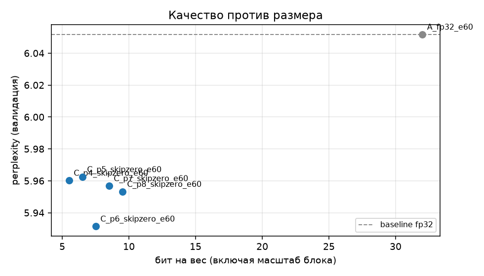
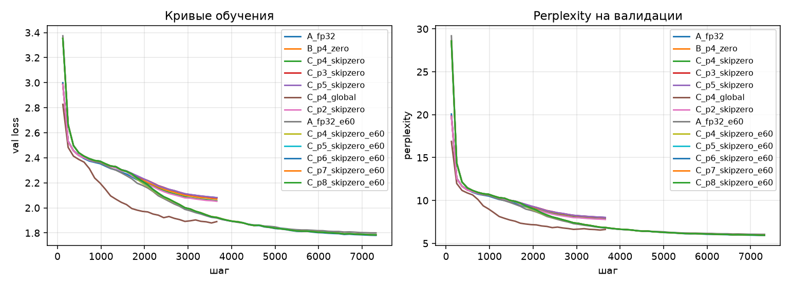

# PoT-NZ: Power-of-Two Quantization without Zero

[](LICENSE)
[](https://www.python.org/)
[](https://pytorch.org/)
[](https://github.com/FirferitAi/PoT-NZ/actions/workflows/tests.yml)

**Abstract.** We present PoT-NZ, a quantization-aware training (QAT) scheme whose
weights are constrained to a uniform grid `w = s · (n/2^p) · k` with
`k ∈ {−2^p, …, −1, 1, …, 2^p}` — the zero level is deliberately excluded. The step
`n/2^p` is an exact power of two, so every grid point is a finite binary fraction, and
the grid contains exactly `2^(p+1)` values, so the code `k → c` occupies exactly
`p+1` bits with no dead code and no zero-point. We train two Transformer language
models (a 0.83M-parameter character-level model and a 7.29M-parameter BPE-16k model)
and report five findings: (i) 5-bit QAT matches fp32 perplexity (5.96 vs 6.05, ratio
0.985); (ii) the fp32 quality ceiling is reached already at 5 bits — `p = 6…8` adds
nothing; (iii) codes pack losslessly into `p+1`-bit streams, giving 4.67× compression
on the small model and 5.64× on the medium model when embeddings and `lm_head` are
quantized as well; (iv) at equal bit width the zero-free grid is on par with int8 while
using all 256 codes, no zero-point and an exact binary step; (v) L1 regularization on the
sparse grid produces 32% exact zeros, which makes the zero-mask format 8.2% smaller than
a dense 5-bit baseline at a 9.4% perplexity cost.

**Keywords:** quantization, quantization-aware training, power-of-two grid, zero-free
quantization, model compression, language models.

**Contents:** [Key results](#key-results) · [Method](#method) · [Setup](#experimental-setup) ·
[Results](#results) · [Limitations](#limitations) · [Reproducibility](#reproducibility) ·
[Repository layout](#repository-layout) · [Reports](#reports-and-theory) ·
[Citation](#citation) · [Русская версия](#pot-nz-квантование-без-нуля-русская-версия)

---

## Key results

| Model | p | Bits/weight | Perplexity (fp32) | `.bin` | Compression |
|---|---|---|---|---|---|
| char 0.83M | 4 | 5.5 | 5.96 (6.05) | 707 KB | **4.67×** |
| BPE-16k 7.29M | 4 | 5.5 | 254.8 (258.8) | 18.7 MB | 1.56× |
| **BPE-16k 7.29M + quantized embedding** | 4 | 5.5 | **239.3** (258.8) | **5.17 MB** | **5.64×** |
| char 0.83M + L1 (32% zeros) | 4 | 5.5 + mask | 5.25 (4.80) | 649 KB (SZM1) | −8.2% vs dense 5-bit |



*Figure 1. Validation perplexity against the number of bits per weight (60 epochs). The
quality plateaus at 5 bits; the dashed line is the fp32 baseline.*

## Method

### Quantization grid

```
w = s · (n / 2^p) · k,    k ∈ {−2^p, …, −1, 1, …, 2^p}
step = n / 2^p
```

where `n` is the half-range and `p` the binary precision. The grid has `2^(p+1)` values
and is symmetric; the zero level is not part of it. Consequently the spacing between
`k = −1` and `k = +1` is twice the nominal step, `n / 2^(p−1)`. This is a deliberate
trade: no dead code, no zero-point, an exact binary step — at the cost of not being able
to represent exactly zero.

### Code mapping (`p+1` bits, all codes used)

```
encode:  c = k + 2^p        if k < 0
         c = k + 2^p − 1    if k > 0
decode:  k = c − 2^p        if c ≤ 2^p − 1
         k = c − 2^p + 1    if c ≥ 2^p
```

For `p = 4`: `k = −16 → c = 0`, `k = −1 → c = 15`, `k = +1 → c = 16`, `k = +16 → c = 31`.
All 32 codes are occupied. A grid that includes zero needs `2^(p+1)+1` values, i.e. `p+2`
bits, or an entropy coder.

### Block scaling

Real weights are not bounded by `[−n, n]`, so each block of 32 weights carries a scale
`s = absmax(block) / n` stored as fp16 (0.5 bit per weight). Hence the effective cost is
`(p+1) + 0.5` bits per weight. Because the scale equals the block maximum, the largest
weight of every block always sits exactly on the grid boundary — the measured "clipping"
share is therefore a structural 3.1–3.8% (1/32), not a quality loss.

### QAT and straight-through estimator

The forward pass uses the quantized weight; gradients pass through:

```
q = round(clamp(w / (s · step), −2^p, 2^p)) · s · step
forward: w + (q − w).detach()
```

L1 regularization (`loss = CE + λ·Σ|w|`) can be enabled to push weights onto the zero
code of the zero-including grid (variant B).

### Bit packing

* `SZP1` — dense stream of `p+1`-bit codes: `"SZP1" | JSON header | codes | fp16 scales | fp32 rest`.
  Eight 5-bit codes occupy exactly 5 bytes.
* `SZM1` — zero-mask format: `"SZM1" | JSON header | 1-bit mask | codes of non-zeros | fp16 scales | fp32 rest`.

Compression against fp32 follows directly:

```
compression = 32 · (q + e) / (q · bits + 32 · e)
```

with `q` quantized and `e` fp32 parameters (embeddings, `lm_head`, LayerNorm, biases).
The ratio depends on `q/(q+e)`, not on the absolute model size.

## Experimental setup

| | Character model | BPE model |
|---|---|---|
| Tokenizer | character-level (65 symbols) | byte-level BPE, 16 000 tokens, trained on the train split |
| Corpus | tiny-shakespeare (1.1 MB), 90/10 split | same corpus, 305 035 tokens |
| Architecture | decoder-only, `d=128`, 4 heads, 4 layers, `d_ff=512`, ctx 128 | decoder-only, `d=256`, 8 heads, 4 layers, `d_ff=1024`, ctx 128, tied embeddings |
| Parameters | 826 368 (786 432 quantized) | 7 288 320 (3 145 728 quantized) |
| Optimizer | AdamW, lr 3e-4, cosine, 5% warmup, grad clip 1.0 | same, batch 32 |
| Training | 30 / 60 epochs, seed 42 | 60 epochs, seed 42 |

Quantized modules: attention/FFN linear layers (`qkv`, `proj`, `fc1`, `fc2`); in the
"embedding" experiments also the token embedding and `lm_head` (`QuantEmbedding`,
`QuantHead`). LayerNorm, biases and positional embeddings stay fp32.

## Results

### Bit-width scaling (character model, 60 epochs, fp32 = 6.05)

| p | bits/weight | perplexity | ratio to fp32 | clip | relative error | `.bin` | compression |
|---|---|---|---|---|---|---|---|
| fp32 | 32 | 6.05 | 1.000 | — | — | 3 310 329 | 1.00× |
| 4 | 5.5 | 5.96 | 0.985 | 3.6% | 5.25% | 707 233 | 4.67× |
| 5 | 6.5 | 5.96 | 0.985 | 3.4% | 2.45% | 805 538 | 4.10× |
| 6 | 7.5 | 5.93 | 0.980 | 3.2% | 1.18% | 903 843 | 3.66× |
| 7 | 8.5 | 5.96 | 0.984 | 3.2% | 0.58% | 1 002 148 | 3.30× |
| 8 | 9.5 | 5.95 | 0.984 | 3.2% | 0.29% | 1 100 453 | 3.00× |

Aggressive end (30 epochs, fp32 = 8.02): `p = 2` → 7.79, `p = 3` → 8.01, `p = 4` → 7.82.
Even 8 levels (3 bits) do not break training. The relative error halves with every bit
(27.1% → 11.4% → 5.08% → 2.45% → 1.18% → 0.58% → 0.29%), as predicted by `2^-p`.



*Figure 2. Validation loss and perplexity during training for the baseline and quantized
runs (character model).*

### Medium model, embedding quantization

| Model | p | Perplexity (fp32) | `.bin` | Compression |
|---|---|---|---|---|
| A fp32 | — | 258.8 | 29 158 216 | 1.00× |
| C, embedding fp32 | 4 | 254.8 | 18 739 941 | 1.56× |
| C, embedding fp32 | 7 | 235.4 | 19 919 619 | 1.46× |
| C + embedding | 7 | 241.1 | 7 887 735 | 3.70× |
| **C + embedding** | 4 | **239.3** | **5 172 084** | **5.64×** |

After QAT the embedding `max|w|` is 0.342–0.367 — inside `[−1, 1]`; the grid clipping is
3.2–3.8%, the zero share is 0%. Quantizing the embedding is the single largest size win:
1.56× → 5.64× at unchanged quality.

### Comparison with int8 (same architecture, character model)

| Method | bits/weight | perplexity | file, bytes | compression |
|---|---|---|---|---|
| fp32 | 32 | 6.052 | 3 310 329 | 1.00× |
| int8, per-block 32 (PTQ) | 8.5 | 6.052 | 995 328 | 3.32× |
| int8, per-tensor (PTQ) | 8.0 | 6.055 | 946 180 | 3.49× |
| PoT-NZ p=7 (QAT) | 8.5 | 5.96 | 1 002 148 | 3.30× |
| PoT-NZ p=6 (QAT) | 7.5 | 5.93 | 903 843 | 3.66× |

At 7.5 bits PoT-NZ matches int8 at 8.5 bits with a 9% smaller file. The structural
advantage: all `2^(p+1)` codes are used (int8 symmetric leaves a zero code and needs a
zero-point), and dequantization is a single multiplication by `2^-p · s`.

### Sparse grids and L1

Zero-including grid (variant B), zero-mask format `SZM1`, character model, 60 epochs,
fp32 baseline 4.80:

| p | λ | zeros | perplexity | ratio | SZM1 bytes | vs dense 5-bit |
|---|---|---|---|---|---|---|
| 4 | 0 | 5.91% | 4.79 | 0.998 | 777 243 | +9.9% |
| 4 | 1e-5 | 18.41% | 4.99 | 1.039 | 715 778 | +1.2% |
| **4** | **2e-5** | **32.01%** | **5.25** | **1.094** | **648 968** | **−8.2%** |
| 4 | 3e-5 | 39.33% | 5.66 | 1.179 | 612 948 | −13.3% |
| 4 | 5e-5 | 43.64% | 6.20 | 1.292 | 591 802 | −16.3% |
| 7 | 0 | 0.73% | 4.79 | 0.998 | 1 095 438 | +55% |
| 7 | 5e-5 | 36.06% | 6.29 | 1.310 | 817 568 | +16% |

The break-even point follows from the formats: `1 + (p+1)(1−f) < p+1` gives `f > 20%` for
`p = 4` against a 5-bit grid, and `f > 50%` for `p = 7`. Empirically the sparse format
wins at `λ = 2e-5` (32% zeros, −8.2% file) and never at `p = 7`. Without code
renumbering the classical threshold is 16.7% (`1 + (p+2)(1−f) < p+2` vs `p+1`), which
matches the "17%" of the original note.

## Limitations

* Two small corpora (tiny-shakespeare), one seed per configuration; differences of
  0.5–1% perplexity between quantized variants are within run-to-run noise.
* The medium model overfits (7.3M parameters on 271k tokens): 60 epochs is past the best
  checkpoint, so both best-checkpoint and final metrics are reported.
* Sparsity is storage-only: the matrices remain dense at inference; no speed-up is claimed.
* The character-model series in `runs/` predates a fix of the embedding initialization
  (`N(0,1)` → `std=0.02`), which lowered the absolute baseline from 6.05 to 4.80. Series in
  `runs_l1/` use the fixed initialization; comparisons are valid within each series.

## Reproducibility

```bash
python -m venv .venv
.venv/bin/pip install torch --index-url https://download.pytorch.org/whl/cu124   # or /cpu
.venv/bin/pip install -r requirements.txt

python tests/test_quant.py        # 10 tests: grid, zero-free encoding, STE
python tests/test_pack.py         # 13 tests: 8×5-bit = 5 bytes, masks, .bin round-trip

python src/train.py --variant C --epochs 60 --tag C_p4
python src/evaluate.py --run runs/C_p4 --sample
python src/verify_pack.py runs/C_p4
python src/run_experiments.py --config config.yaml --spec experiments.yaml

python src/run_experiments.py --config config_medium.yaml --spec experiments_medium.yaml
python src/run_experiments.py --config config_l1.yaml --spec experiments_l1_all.yaml
```

A single 60-epoch run on the character model takes ≈ 2.5 minutes on an RTX 3060; the
medium model ≈ 4 minutes.

**Repository size.** The tracked payload is ≈ 15 MB (largest file 5.2 MB); training
checkpoints and intermediate packed dumps are excluded by `.gitignore`. Run
`python tools/check_repo.py` before publishing — it verifies the GitHub limits
(100 MB per file for `git push`, 25 MB per file for the web UI, repo < 1 GB).

## Repository layout

```
src/quant.py            zero-free grid, QuantLinear/QuantEmbedding, STE, diagnostics
src/model.py            decoder-only Transformer (quantized attention/FFN, optional embedding)
src/data.py             character and BPE tokenizers, 90/10 split
src/train.py            QAT loop, cosine schedule, L1 regularization
src/evaluate.py         perplexity, zero/clip statistics, `.bin` sizes, sampling
src/pack.py             SZP1/SZM1 packing, model assembly and parsing
src/verify_pack.py      unpack(pack(codes)) == codes, perplexity from file
src/verify_sparse.py    zero-mask verification and break-even analysis
src/verify_deploy.py    weight reconstruction without loss
src/run_experiments.py  experiment series and summary tables
src/int8_baseline.py    int8 PTQ baseline
src/medium_stats.py     medium-model statistics, weight ranges
src/check_embedding.py  embedding range before/after QAT
src/l1_report.py        L1 sweep summary
tools/check_repo.py     pre-publish size check against GitHub limits
tests/                  23 unit tests
runs/                   logs, reports, figures, packed model weights
runs_medium/, runs_l1/  medium-model and L1 experiment artifacts
data/                   tiny-shakespeare corpus and BPE-16k tokenizer
theory/                 theory document (Russian)
reports/                cleaned experiment reports
docs/                   legacy documentation (Russian)
```

## Reports and theory

* [`reports/01-bit-packing.md`](reports/01-bit-packing.md) — bit packing and bit-width scaling
* [`reports/02-sparse-mask.md`](reports/02-sparse-mask.md) — zero-mask format and break-even
* [`reports/03-medium-model.md`](reports/03-medium-model.md) — BPE model and compression ratio
* [`reports/04-embedding-and-l1.md`](reports/04-embedding-and-l1.md) — embedding quantization and L1 sparsity
* [`theory/THEORY.md`](theory/THEORY.md) — the method in full (English)
* [`theory/ТЕОРИЯ PoT-NZ.txt`](theory/ТЕОРИЯ%20PoT-NZ.txt) — theory document (Russian)

Released weights:

| file | model | p | bits/weight | compression |
|---|---|---|---|---|
| `runs/C_p4_skipzero/weights_packed.bin` | char 0.83M | 4 | 5.5 | 4.67× |
| `runs_medium/C_p4E_medium/weights_packed.bin` | BPE-16k 7.29M | 4 | 5.5 | 5.64× |

```python
import sys; sys.path.insert(0, "src")
from pack import read_header, unpack_model
header = read_header("runs/C_p4_skipzero/weights_packed.bin")   # config + quantizer
state = unpack_model("runs/C_p4_skipzero/weights_packed.bin")[1]  # tensors, zeros in place
```

## Citation

```bibtex
@misc{potnz2026,
  title  = {PoT-NZ: Power-of-Two Quantization without Zero},
  author = {FiferitAi},
  year   = {2026},
  note   = {Quantization-aware training on a zero-free power-of-two grid},
  url    = {https://github.com/FirferitAi/PoT-NZ}
}
```

See [`CITATION.cff`](CITATION.cff).

## License

MIT — see [`LICENSE`](LICENSE). Copyright (c) 2026 FiferitAi.

---
---

# PoT-NZ: квантование без нуля (русская версия)

**Аннотация.** PoT-NZ — схема обучения с квантованием (QAT), в которой веса лежат на
равномерной сетке `w = s · (n/2^p) · k`, `k ∈ {−2^p, …, −1, 1, …, 2^p}`: уровень нуля
намеренно исключён. Шаг `n/2^p` — точная степень двойки, поэтому каждая точка сетки
представима конечной двоичной дробью, а значений ровно `2^(p+1)` — код `k → c`
занимает ровно `p+1` бит, без «мёртвых» кодов и без zero-point. Мы обучаем две
текстовые модели (char-level 0.83M и BPE-16k 7.29M) и получаем пять результатов:
(i) 5-битное QAT не уступает fp32 по perplexity (5.96 против 6.05, отношение 0.985);
(ii) потолок fp32 достигается уже на 5 битах — `p = 6…8` ничего не добавляют;
(iii) коды упаковываются без потерь в поток `p+1` бит, что даёт сжатие 4.67× на
маленькой модели и 5.64× на средней при квантовании эмбеддинга и `lm_head`;
(iv) при равной разрядности сетка без нуля не уступает int8, используя все 256 кодов,
без zero-point и с точным двоичным шагом; (v) L1-регуляризация на разреженной сетке
даёт 32% точных нулей, и формат с маской становится на 8.2% меньше плотной 5-битной
сетки при росте perplexity на 9.4%.

**Ключевые слова:** квантование, QAT, сетка-степень двойки, квантование без нуля,
сжатие моделей, языковые модели.

## Ключевые результаты

| Модель | p | Бит/вес | Perplexity (fp32) | `.bin` | Сжатие |
|---|---|---|---|---|---|
| char 0.83M | 4 | 5.5 | 5.96 (6.05) | 707 КБ | **4.67×** |
| BPE-16k 7.29M | 4 | 5.5 | 254.8 (258.8) | 18.7 МБ | 1.56× |
| **BPE-16k 7.29M + квантованный эмбеддинг** | 4 | 5.5 | **239.3** (258.8) | **5.17 МБ** | **5.64×** |
| char 0.83M + L1 (32% нулей) | 4 | 5.5 + маска | 5.25 (4.80) | 649 КБ (SZM1) | −8.2% к плотной 5-битной |


*Рисунок 1. Perplexity на валидации в зависимости от числа бит на вес (60 эпох).
Качество выходит на плато на 5 битах; пунктир — базовый уровень fp32.*

## Метод

### Сетка квантования

```
w = s · (n / 2^p) · k,    k ∈ {−2^p, …, −1, 1, …, 2^p}
шаг = n / 2^p
```

`n` — полудиапазон, `p` — двоичная точность. Сетка содержит `2^(p+1)` значений и
симметрична; нуля в ней нет. Поэтому расстояние между `k = −1` и `k = +1` вдвое больше
номинального шага — `n / 2^(p−1)`. Это осознанный обмен: нет мёртвого кода, нет
zero-point, шаг двоичный — ценой невозможности представить ровно ноль.

### Кодирование (`p+1` бит, все коды заняты)

```
код:     c = k + 2^p        при k < 0
         c = k + 2^p − 1    при k > 0
декод:   k = c − 2^p        при c ≤ 2^p − 1
         k = c − 2^p + 1    при c ≥ 2^p
```

Для `p = 4`: `k = −16 → c = 0`, `k = −1 → c = 15`, `k = +1 → c = 16`, `k = +16 → c = 31`.
Заняты все 32 кода. Сетке с нулём нужно `2^(p+1)+1` значений, то есть `p+2` бита, либо
энтропийное кодирование.

### Масштаб на блок

Веса не ограничены `[−n, n]`, поэтому каждый блок из 32 весов несёт масштаб
`s = absmax(block) / n`, который хранится в fp16 (0.5 бита на вес). Итоговая стоимость —
`(p+1) + 0.5` бита на вес. Так как масштаб равен максимуму блока, самый большой вес
каждого блока всегда лежит на границе сетки: измеряемая доля «клипа» — структурные
3.1–3.8% (1/32), а не потеря качества.

### QAT и straight-through estimator

Прямой проход использует квантованный вес, градиент проходит насквозь:

```
q = round(clamp(w / (s · шаг), −2^p, 2^p)) · s · шаг
forward: w + (q − w).detach()
```

L1-регуляризация (`loss = CE + λ·Σ|w|`) включает вариант B — сетку с нулём.

### Упаковка бит

* `SZP1` — плотный поток кодов по `p+1` бит: `"SZP1" | JSON | коды | масштабы fp16 | fp32-прочее`.
  Восемь 5-битных кодов занимают ровно 5 байт.
* `SZM1` — формат с маской нулей: `"SZM1" | JSON | маска 1 бит | коды ненулевых | масштабы fp16 | fp32-прочее`.

Сжатие относительно fp32:

```
сжатие = 32 · (q + e) / (q · биты + 32 · e)
```

где `q` — квантуемые, `e` — fp32-параметры (эмбеддинг, `lm_head`, LayerNorm, bias).
Отношение зависит от `q/(q+e)`, а не от абсолютного размера модели.

## Постановка экспериментов

| | Char-модель | BPE-модель |
|---|---|---|
| Токенизация | посимвольная (65 символов) | byte-level BPE, 16 000 токенов, обучен на train |
| Корпус | tiny-shakespeare (1.1 МБ), split 90/10 | тот же корпус, 305 035 токенов |
| Архитектура | decoder-only, `d=128`, 4 головы, 4 слоя, `d_ff=512`, ctx 128 | decoder-only, `d=256`, 8 голов, 4 слоя, `d_ff=1024`, ctx 128, tied embeddings |
| Параметры | 826 368 (786 432 квантуется) | 7 288 320 (3 145 728 квантуется) |
| Оптимизатор | AdamW, lr 3e-4, cosine, 5% warmup, grad clip 1.0 | то же, batch 32 |
| Обучение | 30 / 60 эпох, seed 42 | 60 эпох, seed 42 |

Квантуются линейные слои attention/FFN (`qkv`, `proj`, `fc1`, `fc2`); в экспериментах
с эмбеддингом — также токенный эмбеддинг и `lm_head` (`QuantEmbedding`, `QuantHead`).
LayerNorm, bias и позиционные эмбеддинги остаются fp32.

## Результаты

### Масштабируемость битности (char-модель, 60 эпох, fp32 = 6.05)

| p | бит/вес | perplexity | к fp32 | клип | отн. ошибка | `.bin` | сжатие |
|---|---|---|---|---|---|---|---|
| fp32 | 32 | 6.05 | 1.000 | — | — | 3 310 329 | 1.00× |
| 4 | 5.5 | 5.96 | 0.985 | 3.6% | 5.25% | 707 233 | 4.67× |
| 5 | 6.5 | 5.96 | 0.985 | 3.4% | 2.45% | 805 538 | 4.10× |
| 6 | 7.5 | 5.93 | 0.980 | 3.2% | 1.18% | 903 843 | 3.66× |
| 7 | 8.5 | 5.96 | 0.984 | 3.2% | 0.58% | 1 002 148 | 3.30× |
| 8 | 9.5 | 5.95 | 0.984 | 3.2% | 0.29% | 1 100 453 | 3.00× |

Агрессивный край (30 эпох, fp32 = 8.02): `p = 2` → 7.79, `p = 3` → 8.01, `p = 4` → 7.82.
Даже 8 уровней (3 бита) не ломают обучение. Относительная ошибка падает вдвое на бит
(27.1% → 11.4% → 5.08% → 2.45% → 1.18% → 0.58% → 0.29%), как и предсказывает `2^-p`.


*Рисунок 2. Валидационные loss и perplexity в процессе обучения для базового и
квантованных прогонов (char-модель).*

### Средняя модель и квантование эмбеддинга

| Модель | p | Perplexity (fp32) | `.bin` | Сжатие |
|---|---|---|---|---|
| A fp32 | — | 258.8 | 29 158 216 | 1.00× |
| C, эмбеддинг fp32 | 4 | 254.8 | 18 739 941 | 1.56× |
| C, эмбеддинг fp32 | 7 | 235.4 | 19 919 619 | 1.46× |
| C + эмбеддинг | 7 | 241.1 | 7 887 735 | 3.70× |
| **C + эмбеддинг** | 4 | **239.3** | **5 172 084** | **5.64×** |

После QAT `max|w|` эмбеддинга 0.342–0.367 — внутри `[−1, 1]`; клип 3.2–3.8%, нулей 0%.
Квантование эмбеддинга — главный выигрыш по размеру: 1.56× → 5.64× без потери качества.

### Сравнение с int8 (та же архитектура, char-модель)

| Метод | бит/вес | perplexity | файл, байт | сжатие |
|---|---|---|---|---|
| fp32 | 32 | 6.052 | 3 310 329 | 1.00× |
| int8, блок 32 (PTQ) | 8.5 | 6.052 | 995 328 | 3.32× |
| int8, тензор (PTQ) | 8.0 | 6.055 | 946 180 | 3.49× |
| PoT-NZ p=7 (QAT) | 8.5 | 5.96 | 1 002 148 | 3.30× |
| PoT-NZ p=6 (QAT) | 7.5 | 5.93 | 903 843 | 3.66× |

На 7.5 битах PoT-NZ догоняет int8 на 8.5 битах при файле на 9% меньше. Структурное
преимущество: заняты все `2^(p+1)` кодов (симметричный int8 оставляет код нуля и требует
zero-point), а де-квантование — одно умножение на `2^-p · s`.

### Разреженные сетки и L1

Сетка с нулём (вариант B), формат `SZM1`, char-модель, 60 эпох, база fp32 = 4.80:

| p | λ | нули | perplexity | к fp32 | байт SZM1 | к плотной 5-битной |
|---|---|---|---|---|---|---|
| 4 | 0 | 5.91% | 4.79 | 0.998 | 777 243 | +9.9% |
| 4 | 1e-5 | 18.41% | 4.99 | 1.039 | 715 778 | +1.2% |
| **4** | **2e-5** | **32.01%** | **5.25** | **1.094** | **648 968** | **−8.2%** |
| 4 | 3e-5 | 39.33% | 5.66 | 1.179 | 612 948 | −13.3% |
| 4 | 5e-5 | 43.64% | 6.20 | 1.292 | 591 802 | −16.3% |
| 7 | 0 | 0.73% | 4.79 | 0.998 | 1 095 438 | +55% |
| 7 | 5e-5 | 36.06% | 6.29 | 1.310 | 817 568 | +16% |

Порог окупаемости следует из форматов: `1 + (p+1)(1−f) < p+1` даёт `f > 20%` при `p = 4`
против 5-битной сетки и `f > 50%` при `p = 7`. На практике разреженный формат выигрывает
при `λ = 2e-5` (32% нулей, −8.2% файла) и никогда — при `p = 7`. Без перенумерации кодов
классический порог 16.7% (`1 + (p+2)(1−f) < p+2` против `p+1`) — это и есть «17%» из
исходной записи теории.

## Ограничения

* Два небольших корпуса (tiny-shakespeare), один seed на конфигурацию; различия 0.5–1%
  perplexity между квантованными вариантами — в пределах шума.
* Средняя модель переобучается (7.3M параметров на 271k токенов): 60 эпох — за пределами
  лучшего чекпоинта, поэтому приводятся и best-checkpoint, и финальные метрики.
* Разреженность только «складская»: матрицы при инференсе остаются плотными, ускорения нет.
* Серия char-модели в `runs/` получена до исправления инициализации эмбеддинга
  (`N(0,1)` → `std=0.02`), из-за чего абсолютная база 6.05; после фикса — 4.80. Серии в
  `runs_l1/` используют исправленную инициализацию; сравнения корректны внутри серий.

## Воспроизведение

```bash
python -m venv .venv
.venv/bin/pip install torch --index-url https://download.pytorch.org/whl/cu124   # или /cpu
.venv/bin/pip install -r requirements.txt

python tests/test_quant.py        # 10 тестов: сетка, кодирование без нуля, STE
python tests/test_pack.py         # 13 тестов: 8×5 бит = 5 байт, маски, round-trip .bin

python src/train.py --variant C --epochs 60 --tag C_p4
python src/evaluate.py --run runs/C_p4 --sample
python src/verify_pack.py runs/C_p4
python src/run_experiments.py --config config.yaml --spec experiments.yaml

python src/run_experiments.py --config config_medium.yaml --spec experiments_medium.yaml
python src/run_experiments.py --config config_l1.yaml --spec experiments_l1_all.yaml
```

Один прогон на 60 эпох для char-модели занимает ≈ 2.5 минуты на RTX 3060, для средней
модели ≈ 4 минуты.

**Размер репозитория.** В git уходит ≈ 15 МБ (самый большой файл 5.2 МБ); чекпоинты и
промежуточные дампы `.bin` исключены через `.gitignore`. Перед публикацией запустите
`python tools/check_repo.py` — скрипт проверяет лимиты GitHub (100 МБ на файл для
`git push`, 25 МБ на файл для веб-интерфейса, репозиторий < 1 ГБ).

## Структура репозитория

```
src/quant.py            сетка без нуля, QuantLinear/QuantEmbedding, STE, диагностика
src/model.py            decoder-only Transformer (квантованные attention/FFN, эмбеддинг опционально)
src/data.py             char- и BPE-токенизаторы, split 90/10
src/train.py            QAT-цикл, cosine, L1-регуляризация
src/evaluate.py         perplexity, статистика нулей/клипа, размеры `.bin`, генерация текста
src/pack.py             упаковка SZP1/SZM1, сборка и разбор .bin
src/verify_pack.py      unpack(pack(codes)) == codes, perplexity из файла
src/verify_sparse.py    проверка маски нулей и порога окупаемости
src/verify_deploy.py    восстановление весов без потерь
src/run_experiments.py  серии прогонов и сводные таблицы
src/int8_baseline.py    базовый int8 (PTQ)
src/medium_stats.py     статистика средней модели и диапазоны весов
src/check_embedding.py  диапазон эмбеддинга до/после QAT
src/l1_report.py        сводка L1-свипа
tools/check_repo.py     проверка размера перед публикацией
tests/                  23 юнит-теста
runs/                   логи, отчёты, графики, упакованные веса
runs_medium/, runs_l1/  артефакты средней модели и L1
data/                   корпус tiny-shakespeare и BPE-16k токенизатор
theory/                 документ теории (русский)
reports/                очищенные отчёты по экспериментам
docs/                   прежняя документация (русский)
```

## Отчёты и теория

* [`reports/01-bit-packing.md`](reports/01-bit-packing.md) — упаковка бит и масштабируемость
* [`reports/02-sparse-mask.md`](reports/02-sparse-mask.md) — маска нулей и порог окупаемости
* [`reports/03-medium-model.md`](reports/03-medium-model.md) — BPE-модель и сжатие
* [`reports/04-embedding-and-l1.md`](reports/04-embedding-and-l1.md) — эмбеддинг и L1-разреженность
* [`theory/THEORY.md`](theory/THEORY.md) — метод полностью (английский)
* [`theory/ТЕОРИЯ PoT-NZ.txt`](theory/ТЕОРИЯ%20PoT-NZ.txt) — теория (русский)

Готовые веса:

| файл | модель | p | бит/вес | сжатие |
|---|---|---|---|---|
| `runs/C_p4_skipzero/weights_packed.bin` | char 0.83M | 4 | 5.5 | 4.67× |
| `runs_medium/C_p4E_medium/weights_packed.bin` | BPE-16k 7.29M | 4 | 5.5 | 5.64× |

```python
import sys; sys.path.insert(0, "src")
from pack import read_header, unpack_model
header = read_header("runs/C_p4_skipzero/weights_packed.bin")   # конфиг + квантователь
state = unpack_model("runs/C_p4_skipzero/weights_packed.bin")[1]  # тензоры, нули на месте
```

## Цитирование

```bibtex
@misc{potnz2026,
  title  = {PoT-NZ: Power-of-Two Quantization without Zero},
  author = {FiferitAi},
  year   = {2026},
  note   = {Quantization-aware training on a zero-free power-of-two grid},
  url    = {https://github.com/FirferitAi/PoT-NZ}
}
```

См. [`CITATION.cff`](CITATION.cff).

## Лицензия

MIT — см. [`LICENSE`](LICENSE). Copyright (c) 2026 FiferitAi.
